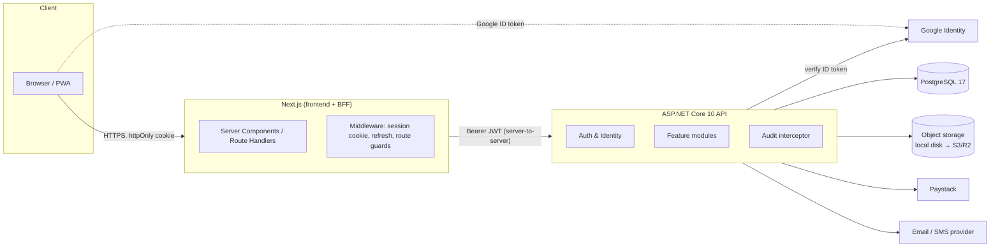

# 01 — System Architecture

## 1. Style: modular monolith

One deployable API, internally split into **feature modules** with explicit boundaries. For a single school (~1k users) microservices would add cost and operational burden with no benefit; a modular monolith keeps one database transaction per use case and can be split later along module lines if ever needed. (See [ADR-003](adr/ADR-003-modular-monolith.md).)



**Key point:** the browser never holds an access or refresh token in JavaScript. Next.js acts as a **Backend-for-Frontend (BFF)**: it stores tokens in `httpOnly; Secure; SameSite=Lax` cookies and calls the API server-side. (See [ADR-002](adr/ADR-002-bff-auth.md).)

## 2. Technology choices

| Layer | Choice | Why |
|---|---|---|
| Backend | **C# / ASP.NET Core 10 (LTS)**, minimal APIs grouped by feature | First-class Identity, EF Core, OpenAPI, rate limiting, built-in validation; LTS to Nov 2028. [ADR-001](adr/ADR-001-backend-dotnet.md) |
| ORM | EF Core 10 + Npgsql | Migrations, LINQ, interceptors for audit |
| Use cases | CQRS command/query handlers per vertical slice, Result pattern, FluentValidation, TypedResults | [ADR-004](adr/ADR-004-code-organisation.md) |
| Database | **PostgreSQL 17** | Relational integrity for academic/financial data, `jsonb` for audit, free, managed options everywhere |
| Auth | ASP.NET Core Identity + JWT access (15 min) + rotating refresh tokens; Google ID-token sign-in | Own the user store; no vendor lock-in; see [04-security](04-security.md) |
| Frontend | **Next.js (App Router) + TypeScript + Tailwind CSS** | SSR/SSG for SEO on the public site, server components for secure data fetching, one codebase for site + portals |
| UI kit | Own components on Radix primitives (accessible), design tokens from brand | See [05-design-system](05-design-system.md) |
| Forms / validation | React Hook Form + Zod (client), DataAnnotations + domain rules (server) | Server is the source of truth |
| API client | Types generated from the API's OpenAPI document | No hand-written DTO drift |
| Files | `IFileStorage` abstraction → local disk in dev, S3-compatible (Cloudflare R2) in prod | Swappable |
| PDF | QuestPDF (server) for report cards & receipts | Pixel-consistent print output |
| Background jobs | `BackgroundService` + outbox table (phase 2) | Notifications, invoice generation; no extra infra |
| Tests | xUnit + Testcontainers (real Postgres) · Vitest · Playwright e2e | Test against the real database engine |
| CI/CD | GitHub Actions → container images | Build, test, lint, migrate, deploy |
| Hosting | API + DB on a managed platform (e.g. Azure App Service / Fly.io / Render + managed Postgres); web on Vercel or same platform | Low ops |
| Observability | Structured logs (OpenTelemetry), health checks, uptime monitor, Sentry for web | |

## 3. Backend solution layout

Clean Architecture projects with **vertical slices** (one folder per use case) inside the Application layer. Full rationale in [ADR-004](adr/ADR-004-code-organisation.md).

```
backend/
  src/
    Maydel.Domain/          # Entities, value objects, enums, domain rules & errors. No framework deps.
    Maydel.Application/     # Use cases: <Module>/<UseCase>/{Command|Query, Handler, Validator}; DTOs; abstractions
    Maydel.Infrastructure/  # EF Core (IAppDbContext), migrations, Identity, storage, email, Paystack, audit interceptor
    Maydel.Api/             # HTTP only: Endpoints/<Module>Endpoints.cs → handler → TypedResults; auth policies; problem details
  tests/
    Maydel.Domain.Tests/       # Fast unit tests of rules
    Maydel.Application.Tests/  # Handler tests against Testcontainers Postgres
    Maydel.Api.Tests/          # HTTP integration: auth, policies, row-level access, contracts
```

Dependencies point inward: `Api → Application → Domain`, `Infrastructure → Application`. Patterns: CQRS handlers (no MediatR), no generic repositories (DbContext is the unit of work), Result pattern for expected failures, `TypedResults` for precise OpenAPI, FluentValidation.

### Module boundaries

| Module | Owns | Talks to |
|---|---|---|
| Identity | users, roles, refresh tokens, Google logins | — |
| School Setup | sessions, terms, class levels, class rooms, subjects, class-subjects, assessment config | — |
| Admissions | applications, pipeline | Students (on enrol) |
| Students (SIS) | students, guardians, links, documents, promotion | Identity (logins) |
| Staff | staff records, assignments, website profiles | Identity |
| Attendance | daily register | Students, School Setup |
| Assessment | scores, term reports, publishing, rankings | Students, Attendance |
| Finance | fee items, invoices, payments, receipts, gateway webhooks | Students |
| Communication | announcements, events, notifications outbox | all (consumer) |
| Website CMS | pages, gallery, news (public flag), enquiries | Communication |
| Portal | read-models for parents/students | Students, Assessment, Finance, Attendance |
| Audit | audit log (append-only) | all (via interceptor) |

Rules: a module only writes its own tables; cross-module reads go through queries, not by mutating another module's entities.

## 4. Request lifecycle (API)

1. Forwarded headers → exception handler (RFC 9457 problem details) → HSTS/security headers → CORS → authentication (JWT + security-stamp check) → authorization (role policies) → rate limiter.
2. Endpoint binds the request and calls the handler; the validation decorator runs FluentValidation; the handler applies **row-level access rules** (parent ↔ child, teacher ↔ class/subject) and returns a `Result`.
3. EF Core unit of work; `AuditInterceptor` stamps timestamps and writes audit rows **in the same transaction**.
4. Expected failures come back as `Result` errors → mapped to problem details (400/403/404/409/422); unexpected exceptions → 500.

## 5. Frontend architecture

```
frontend/src/
  app/
    (site)/            # Public website: SSG/ISR, SEO metadata — home, about, admissions, parents, staff, gallery, news, contact
    (auth)/login/      # Sign-in (password + Google), change password
    (console)/admin/   # Staff console: dashboard, students, staff, academics, assessment, attendance, finance, admissions, cms, audit
    (portal)/portal/   # Parent/student portal: children switcher, results, fees, attendance, notices
    api/auth/*         # BFF route handlers: login, google, refresh, logout (set/clear httpOnly cookies)
  components/ui/       # Design-system primitives
  components/<feature>/
  lib/api/             # Typed server-side API client (generated types), session handling
  middleware.ts        # Route protection by role; silent refresh
```

- Public pages are statically generated and revalidated (ISR) from public API endpoints — fast and SEO-friendly.
- Console and portal are server-rendered per request using the session cookie; mutations via Server Actions or BFF route handlers.
- Role-based route guards in `middleware.ts` are **UX only**; the API is the security boundary.

## 6. Data & environments

| Env | Purpose | Data |
|---|---|---|
| local | dev via `docker compose` | demo seed |
| staging | PR previews / UAT with school staff | anonymised copy |
| production | live | real; daily backups, 30-day PITR |

Migrations run as a separate deploy step (not on app start in production). Secrets come from environment / secret store — never from `appsettings.json`.

## 7. Scalability & performance notes

- Stateless API (JWT) → horizontal scaling behind a load balancer if ever needed; rate-limit store would move to Redis then.
- Indexed hot paths: student search (name/admission no.), scores by (class, term, subject), attendance by (class, date), invoices by (student, term).
- Report-card computation is per class (≤ 40 students) — sub-second; positions are frozen at publish.
- Images resized on upload; served via CDN in production.

## 8. Backend ↔ frontend contract workflow

Monorepo: `backend/` and `frontend/` live side by side in this repo, so one change can update the API, the contract and the UI together.

1. **Contract first, per story.** The backend slice is built first. Its OpenAPI document is exported to `contracts/openapi.json` (`dotnet build` runs `Microsoft.Extensions.ApiDescription.Server`) and committed. Reviewing a PR shows any contract diff.
2. **Generated client.** `frontend` runs `npm run api:types` (openapi-typescript) to produce `src/lib/api/schema.d.ts`. API calls are typed end to end, so a backend change that breaks the UI fails `npm run typecheck`.
3. **One session, vertical slices (default).** A single Claude Code session works from the `maydel-sms/` root and takes each story through backend → contract → frontend → tests. This avoids drift between two agents.
4. **Parallel sessions (optional, to go faster).** Once a milestone's contract is committed, a second session can build the frontend from `contracts/openapi.json`, using MSW mocks generated from the contract while the backend is still in progress. Both sessions follow `CLAUDE.md` and `docs/prompts/execute-epic.md`.
