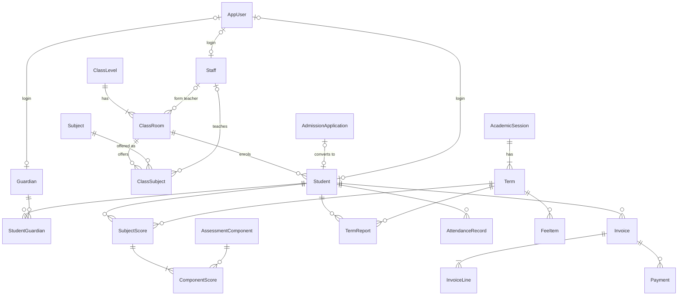
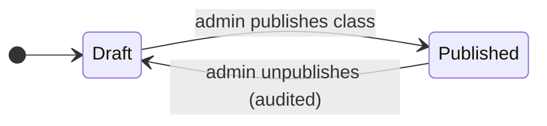

# 03 — Domain Model

All entities use `Guid` v7 ids (time-ordered, index-friendly), `CreatedAt`/`UpdatedAt` stamped by the persistence layer. Enums are stored as strings for readable data. Money is `numeric(12,2)` in NGN.



## Aggregates & invariants

| Aggregate | Invariants (enforced in domain/API, covered by tests) |
|---|---|
| **AcademicSession / Term** | Name `YYYY/YYYY` unique; one term number per session; exactly one current term; end > start |
| **ClassRoom** | (level, arm) unique; capacity ≥ 1 |
| **ClassSubject** | (class room, subject) unique |
| **Student** | Admission number unique, server-generated; one login max; leaving the school disables the login |
| **Guardian** | Reused by phone number across siblings; one login max; only Parent-role accounts |
| **AssessmentComponent** | Active components sum to 100; components with history are deactivated, never deleted |
| **GradeBand** | Starts at 0; unique minimum; lookup = highest band whose min ≤ score (no gaps for 69.5) |
| **SubjectScore** | (student, term, subject) unique; each component 0..max; total & grade recomputed on save; immutable while report published |
| **TermReport** | (student, term) unique; Draft → Published; on publish freezes average, class average, position (competition ranking), class size, attendance |
| **AttendanceRecord** | (student, date) unique; Present & Late count as present |
| **Invoice** | Number unique; balance = Σlines − Σpayments; payment > 0 and ≤ balance; no payments on cancelled |
| **Payment** | Receipt number unique; immutable (reversals are new entries) |
| **AuditLog** | Append-only; secrets redacted |

## Status models

```mermaid
stateDiagram-v2
    direction LR
    state "Admission application" as A {
        [*] --> New --> Contacted --> AssessmentScheduled --> Offered --> Enrolled
        Offered --> Declined
        Contacted --> Declined
    }
```



Student: `Active ⇄ Suspended`, `Active → Withdrawn | Graduated`.
Invoice (derived): `Unpaid → PartiallyPaid → Paid`, any → `Cancelled` (only with no payments).

## Legacy → new mapping (for E8 migration)

| Firestore `students` field | New model |
|---|---|
| `name` | Student.FirstName / LastName (split on last space; manual review list) |
| `studentClass` "Year N" | ClassRoom "Year N A" |
| `studentId` / `loginEmail` | Student.AdmissionNumber (kept if unique, else regenerated + mapping report) |
| `parentLoginEmail` shared across siblings | one Guardian linked to each sibling |
| `guardianName/Phone/Email` | Guardian |
| `photoUrl` | downloaded → `students/` private storage |
| `totalFees` / `amountPaid` | opening-balance Invoice + Payment for the current term |
| `results[]` `{term, session, subjects[{name, components, grade, remark, comment}], schoolOpened, timesPresent, comment}` | Term (matched by name/session) · SubjectScore per subject (subject names normalised with the legacy alias table) · TermReport (Published, attendance from legacy numbers) |
| `adminActivity` | AuditLog (Action = "Legacy") |
